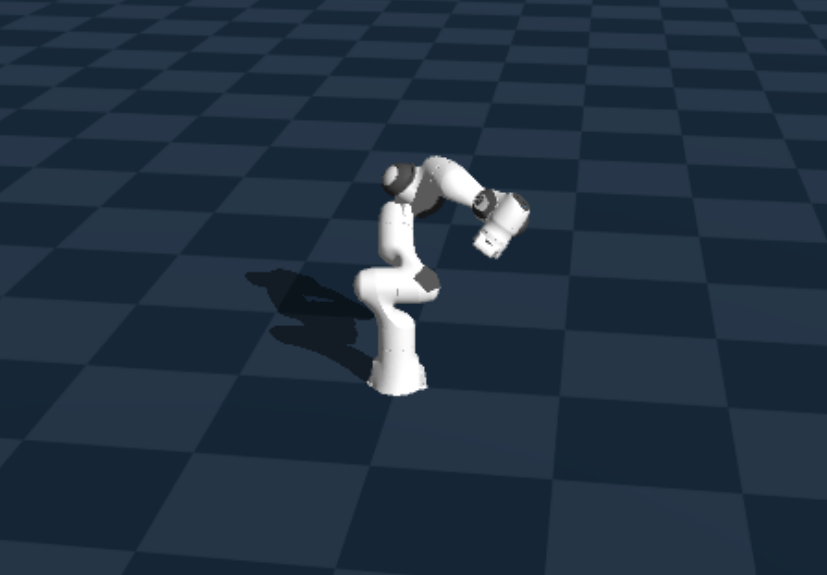

# Advanced Robot Control and Learning Project



## Overview

In this repository, we implement and evaluate the **QP-based hierarchical controller** proposed by Hoffman et al. [[1]](#references) on a 7-DoF Franka Emika Panda robotic arm in simulation.

We evaluate the controller in three experiments using the Genesis physics simulator and compare the performance of the proposed controller with a traditional nullspace-based hierarchical controller.

For details on the implementation and results, please refer to [`resources/ARCL_project_summary.pdf`](resources/ARCL_project_summary.pdf).

## Setup

Create a virtual environment and install the required dependencies:

```bash
python3 -m venv .venv
source .venv/bin/activate
pip install -r ./requirements.txt
```

## Running the Experiments

Run the experiments using the Jupyter notebook:

[`experiments.ipynb`](experiments.ipynb)


## Authors

Kadri Bajrami and Moritz Geissler

## References

[1] E. M. Hoffman, A. Laurenzi, L. Muratore, N. G. Tsagarakis, and D. G. Caldwell, "Multi-Priority Cartesian Impedance Control Based on Quadratic Programming Optimization," *2018 IEEE International Conference on Robotics and Automation (ICRA)*, Brisbane, QLD, Australia, 2018, pp. 309–315. DOI: [10.1109/ICRA.2018.8462877](https://doi.org/10.1109/ICRA.2018.8462877).